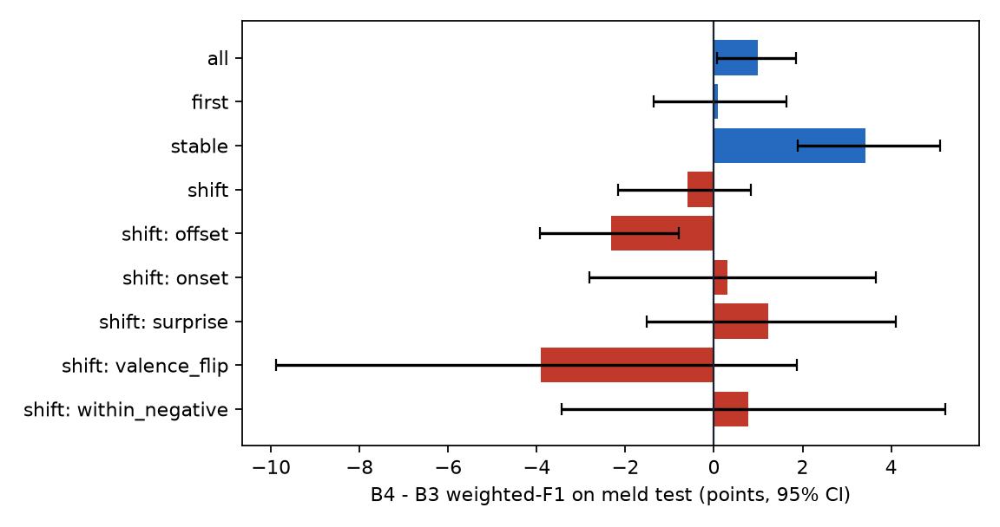
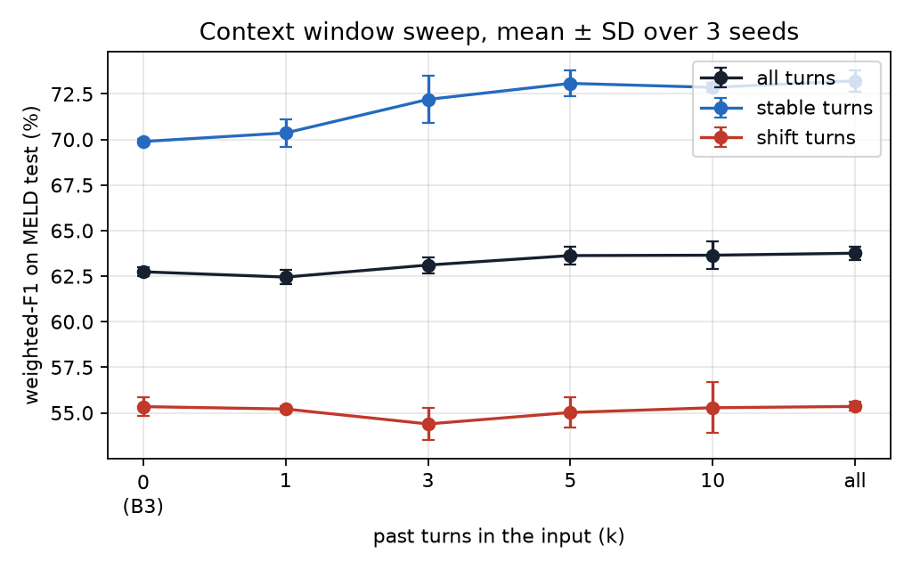

# B4 · RoBERTa with context (workstream #5)

Status: **done** (MELD: window sweep, B4, B4+, controls; DailyDialog: B4, controls).

Trained on a Colab T4 with [`notebooks/b4_colab.ipynb`](../notebooks/b4_colab.ipynb)
(`python scripts/train_b4.py`, about 3.5 hours for MELD and 4.5 hours for DailyDialog), then `python scripts/analyse_b4.py` on a
laptop (seconds). Every number below is in [`reports/b4/results.md`](../reports/b4/results.md) and can be
recomputed from `predictions/b4_*.csv`, `predictions/b4plus_*.csv` and `reports/b4/<dataset>/preds/`.

## What it is

The context-aware transformer from the proposal (B4): the same RoBERTa-base, head, optimiser settings and epochs
as B3, so that **B4 − B3 measures the effect of context alone**. The only change is the input. Each utterance is
fed with the turns before it and the speaker names, EmoBERTa-style, with the current utterance last:

```
Monica: Oh my God! </s> Chandler: What? </s> Monica: I can't believe it.
|------------- past k turns -------------|   |---- current utterance ---|
```

- Code: `emotionshift/models/roberta_context.py` (`context_inputs`, `RobertaContext`), tests in
  `tests/test_roberta_context.py`
- Config: `configs/b4_context.yaml` — lr 1e-5, batch 32, 4 epochs on MELD and 3 on DailyDialog, fp16, max 256 tokens. Inputs that are
  too long are cut **from the left**, so the oldest context goes first and the current utterance is always kept
- Past turns only (causal), so the model can label a conversation turn by turn
- **Window sweep (E3)**: k ∈ {1, 3, 5, 10, all} × 3 seeds on MELD. The window is chosen on **dev only**
  (mean dev weighted-F1): **k = all**. Dev means: 59.44 / 60.15 / 60.04 / 60.06 / **60.76**
- **B4+ (R3 fallback)**: B4 at k = all with class-weighted cross-entropy ("balanced" weights), 5 seeds

## Results on MELD test

Mean ± SD over 5 seeds, [95% dialogue-bootstrap CI of the seed mean], in %.

| Model | Weighted-F1 | Macro-F1 | Micro-F1 excl. neutral | Derived shift F1 |
|---|---|---|---|---|
| B3 RoBERTa, utterance only | 62.85 ± 0.31 | 40.56 ± 0.80 | 49.88 | 72.02 |
| **B4 RoBERTa + context (k = all)** | **63.82 ± 0.30** [61.7, 65.9] | 41.09 ± 0.23 [39.5, 42.5] | 51.80 ± 0.46 | 72.53 ± 0.89 |
| B4+ class-weighted (k = all) | 59.45 ± 0.76 [57.6, 61.3] | **44.11 ± 1.11** [41.9, 46.1] | 47.20 ± 0.72 | 70.90 ± 0.56 |

Against the proposal's targets (group summary, `reports/summary/summary.md`):

| Target | Result | Status |
|---|---|---|
| R2: context RoBERTa ≥ 62 weighted-F1 on MELD | 63.82 | met |
| R3: B4+ beats B3 on MELD macro-F1, CI excludes 0 | +3.55 [+1.52, +5.47] | met |
| H1: the context gain is on stable turns, not on shift turns | stable +3.42 [+1.88, +5.05]; shift −0.60 [−1.98, +0.82] | met |
| H3: ShiftAware ≥ +2 over B4 on MELD shift turns | −0.36 [−2.44, +1.71] | not met |

- **Context helps a little overall** (+0.98 weighted-F1, CI [+0.07, +1.85]), in line with EmoBERTa
  (63.46 → 64.55 with past turns, RoBERTa-large).
- **B4+ trades weighted-F1 for macro-F1.** Class weights make the model predict the rare classes: disgust F1
  0 → 17.8 and fear 0 → 23.9 (seed 0), while neutral drops from 80.5 to 71.1, so weighted-F1 falls 4.4 points.
  R3 is about macro-F1 and is met; B4 (unweighted) stays the headline context model.

### Where the context gain comes from (E2 / H1)

B4 − B3, weighted-F1, 5 seed pairs, 95% dialogue-bootstrap CI.

| Group | n | B3 | B4 | B4 − B3 | 95% CI |
|---|---|---|---|---|---|
| all | 2610 | 62.85 | 63.82 | +0.98 | [+0.07, +1.85] |
| first turn of a speaker | 746 | 65.18 | 65.27 | +0.09 | [−1.37, +1.64] |
| **stable** | 861 | 69.73 | 73.15 | **+3.42** | [+1.90, +5.11] |
| **shift** | 1003 | 55.91 | 55.30 | **−0.60** | [−2.16, +0.83] |
| shift: offset (→ neutral) | 340 | 91.81 | 89.48 | −2.33 | [−3.92, −0.79] |
| shift: onset (neutral →) | 355 | 50.25 | 50.54 | +0.30 | [−2.82, +3.65] |
| shift: surprise | 158 | 60.84 | 62.06 | +1.22 | [−1.51, +4.11] |
| shift: valence flip | 69 | 57.77 | 53.85 | −3.91 | [−9.89, +1.87] |
| shift: within negative | 81 | 31.78 | 32.55 | +0.77 | [−3.44, +5.23] |

**All of the gain is on stable turns.** On turns where the speaker's emotion changes, context does not help, and
on offsets (an emotion returning to neutral) it hurts: the model has learnt that emotions persist. The gap
between stable and shift turns grows from 13.8 points (B3) to 17.9 (B4). This is the pattern H1 predicted.



### Context window sweep (E3)

Weighted-F1 on MELD test, mean ± SD over 3 seeds. k = 0 is B3.

| k | Dev, all | Test, all | Test, first | Test, stable | Test, shift |
|---|---|---|---|---|---|
| 0 (B3) | – | 62.74 ± 0.23 | 65.42 ± 0.30 | 69.89 ± 0.12 | 55.34 ± 0.53 |
| 1 | 59.44 ± 0.55 | 62.45 ± 0.40 | 63.95 ± 0.38 | 70.36 ± 0.77 | 55.21 ± 0.14 |
| 3 | 60.17 ± 0.61 | 63.11 ± 0.44 | 65.12 ± 0.41 | 72.20 ± 1.30 | 54.39 ± 0.87 |
| 5 | 60.04 ± 0.27 | 63.63 ± 0.49 | 65.14 ± 0.15 | 73.08 ± 0.72 | 55.02 ± 0.84 |
| 10 | 60.06 ± 0.69 | 63.65 ± 0.74 | 64.98 ± 0.64 | 72.86 ± 0.23 | 55.28 ± 1.39 |
| all | 60.76 ± 0.64 | 63.76 ± 0.37 | 64.92 ± 0.86 | 73.22 ± 0.58 | 55.35 ± 0.25 |

More context raises the stable-turn score (69.9 → 73.2) and leaves the shift-turn score flat (55.3 → 55.4) at
every window. One past turn is not enough: k = 1 is no better than B3.



### Input controls (E4)

The five trained B4 models, with their **test input** changed (no retraining). Weighted-F1, MELD test.

| Input | All | First | Stable | Shift |
|---|---|---|---|---|
| B3 (trained without context) | 62.85 ± 0.31 | 65.18 ± 0.51 | 69.73 ± 0.24 | 55.91 ± 0.91 |
| real context (B4) | 63.82 ± 0.30 | 65.27 ± 0.81 | 73.15 ± 0.65 | 55.30 ± 0.19 |
| no context at test | 62.06 ± 0.48 | 64.00 ± 0.56 | 69.53 ± 0.59 | 54.96 ± 0.51 |
| shuffled context (same number of turns, other dialogues) | 61.82 ± 0.26 | 64.61 ± 0.70 | 68.70 ± 0.44 | 54.63 ± 0.64 |
| shuffled speakers (within the dialogue) | 63.56 ± 0.12 | 64.90 ± 0.52 | 72.89 ± 0.42 | 55.14 ± 0.71 |

- **H2**: shuffled context recovers none of the gain (61.82, below B3), so the model uses what the previous turns
  say, not just the fact that there are some. H2 asked for "less than half": met.
- **Speaker names matter little**: shuffling them costs 0.26 points.
- Not done: control (c), oracle gold history. B4 never sees labels, so that upper bound belongs to the B0 oracle
  rows; and the B4 forecasting baseline (E6, current utterance masked).

### Efficiency (E9)

| Window | Train time per seed (T4) | CPU latency per utterance (median) | Batch throughput (T4) |
|---|---|---|---|
| k = 1 | 6.2 min | 132 ms | 1031 utt/s |
| k = 3 | 7.0 min | 180 ms | 647 utt/s |
| k = 5 | 10.4 min | 208 ms | 503 utt/s |
| k = 10 | 10.4 min | 256 ms | 336 utt/s |
| k = all | 11.7 min | 257 ms (p95 511 ms) | 288 utt/s |

124.7 M parameters, 502 MB, the same network as B3. A full-history input costs about 2.5× B3's CPU latency
(106 ms) and its p95 is above the demo's 300 ms budget; k = 3 stays inside it. Seed-0 runs; the 5-seed mean
train time at k = all is 10.4 min.

## Results on DailyDialog

B4 at the window chosen on MELD dev (k = all), 3 epochs, 5 seeds. Headline: micro-F1 without neutral on the
de-duplicated test set. Dev scores per seed: 62.14 / 62.29 / 62.25 / 61.49 / 62.30.

| Model | Test split | n | Micro-F1 excl. neutral | Macro-F1 | Weighted-F1 | Derived shift F1 |
|---|---|---|---|---|---|---|
| B3 RoBERTa, utterance only | test_dedup | 7019 | 55.34 ± 0.39 | 39.69 ± 1.09 | 84.80 | 52.28 |
| **B4 RoBERTa + context (k = all)** | test_dedup | 7019 | **59.61 ± 0.34** [56.9, 62.3] | **47.45 ± 1.99** [42.1, 51.5] | 85.63 ± 0.17 | 52.78 ± 0.95 |
| B4 RoBERTa + context (k = all) | test | 7740 | 59.66 ± 0.26 [56.9, 62.2] | 49.04 ± 2.22 [43.5, 53.2] | 85.51 ± 0.12 | 52.63 ± 0.94 |

- **Context helps much more than on MELD**: +4.27 micro-F1 over B3 (95% CI [+2.41, +6.16], p < 0.001) and
  +7.76 macro-F1. B4 is the best model of the group on DailyDialog, ahead of ShiftAware (57.39) by
  2.22 [0.69, 3.67], and above the published COSMIC score (about 58) quoted in the proposal.
- **The gain is again larger on stable turns** (headline metric): stable 37.89 → 45.23, **+7.34** [+3.90, +10.69];
  shift 71.46 → 74.06, **+2.60** [+0.43, +4.82]. Unlike on MELD, shift turns do gain a little.
- **By shift type** (weighted-F1, table in `reports/b4/results.md`): onsets (neutral → emotion) gain +5.78
  [+3.47, +7.98], offsets (emotion → neutral) lose 4.78 [−6.99, −2.93]. The same offset loss as on MELD: with
  context the model holds on to the previous emotion.
- Rare classes improve without class weights (seed 0): sadness 19.6 → 34.3, disgust 8.5 → 21.4, fear 18.2 → 33.3.

### Input controls (E4), micro-F1 excl. neutral, test_dedup

| Input | All | First | Stable | Shift |
|---|---|---|---|---|
| B3 (trained without context) | 55.34 ± 0.39 | 52.67 ± 1.35 | 37.89 ± 0.43 | 71.46 ± 1.11 |
| real context (B4) | 59.61 ± 0.34 | 57.05 ± 1.17 | 45.23 ± 0.92 | 74.06 ± 0.78 |
| no context at test | 52.92 ± 0.52 | 53.40 ± 0.97 | 37.22 ± 0.60 | 66.59 ± 1.14 |
| shuffled context | 50.52 ± 0.42 | 51.97 ± 1.32 | 31.90 ± 0.73 | 66.60 ± 0.76 |
| shuffled speakers | 59.70 ± 0.37 | 56.76 ± 1.19 | 45.57 ± 0.73 | 74.03 ± 0.93 |

Shuffled context is 9 points below real context and below B3, so H2 holds here too. Speaker names (A / B) carry
nothing: shuffling them changes the score by 0.09.

Efficiency: 51.6 min per seed on a T4 (B3: 14.0 min), CPU latency 211 ms median / 472 ms p95 per utterance,
292 utt/s in batches.

## Limits

- The window was swept on MELD only; DailyDialog reuses k = all. B4+ was trained on MELD only.
- Controls change the test input of models trained on real context; models retrained on shuffled context could
  behave differently.
- Trained model weights are not kept (Colab disk); retrain one seed with the notebook to get a checkpoint.
- The dev column of the sweep table is recomputed from saved predictions and can differ from the training-time
  dev score in `selection.json` by a few hundredths (mixed-precision inference).
