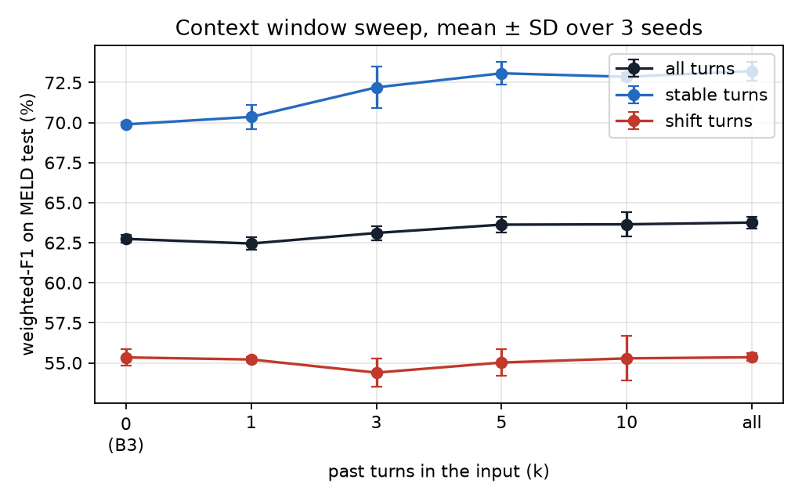
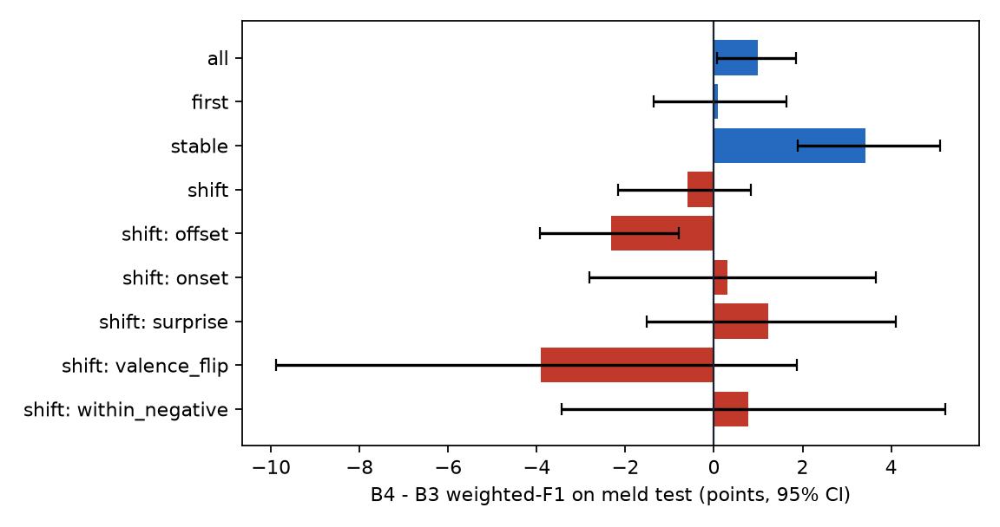
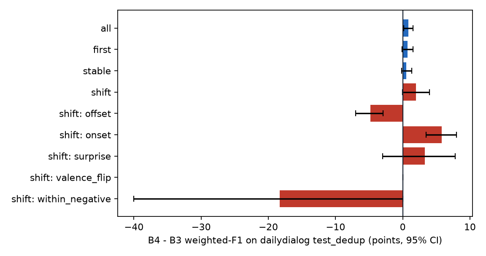

# B4 RoBERTa with context (workstream 5) results

RoBERTa-base with speaker names and the past k turns. Window chosen on MELD dev: **k = all** (dev weighted_f1, mean over seeds [0, 1, 2]). Mean ± SD over seeds, [95% dialogue-bootstrap CI of the seed mean], in %.

| Model | Dataset | Test split | Seeds | n | Weighted-F1 | Macro-F1 | Micro-F1 excl. neutral | Derived shift F1 |
|---|---|---|---|---|---|---|---|---|
| B4 RoBERTa + context (k = all) | meld | test | 5 | 2610 | 63.82 ± 0.30 [61.7, 65.9] | 41.09 ± 0.23 [39.5, 42.5] | 51.80 ± 0.46 [49.3, 54.2] | 72.53 ± 0.89 |
| B4+ class-weighted (k = all) | meld | test | 5 | 2610 | 59.45 ± 0.76 [57.6, 61.3] | 44.11 ± 1.11 [41.9, 46.1] | 47.20 ± 0.72 [44.7, 49.6] | 70.90 ± 0.56 |
| B4 RoBERTa + context (k = all) | dailydialog | test_dedup | 5 | 7019 | 85.63 ± 0.17 [84.4, 86.8] | 47.45 ± 1.99 [42.1, 51.5] | 59.61 ± 0.34 [56.9, 62.3] | 52.78 ± 0.95 |
| B4 RoBERTa + context (k = all) | dailydialog | test | 5 | 7740 | 85.51 ± 0.12 [84.4, 86.6] | 49.04 ± 2.22 [43.5, 53.2] | 59.66 ± 0.26 [56.9, 62.2] | 52.63 ± 0.94 |

## R3: B4+ against B3 on MELD macro-F1

B4+ - B3 = **+3.55** points, 95% CI [+1.55, +5.58] (5 seed pairs, dialogue bootstrap).

## E3: context window sweep (MELD, weighted-F1, %)

| k | Seeds | Dev, all | Test, all | Test, first | Test, stable | Test, shift |
|---|---|---|---|---|---|---|
| 0 (B3) | 3 | - | 62.74 ± 0.23 | 65.42 ± 0.30 | 69.89 ± 0.12 | 55.34 ± 0.53 |
| 1 | 3 | 59.44 ± 0.55 | 62.45 ± 0.40 | 63.95 ± 0.38 | 70.36 ± 0.77 | 55.21 ± 0.14 |
| 3 | 3 | 60.17 ± 0.61 | 63.11 ± 0.44 | 65.12 ± 0.41 | 72.20 ± 1.30 | 54.39 ± 0.87 |
| 5 | 3 | 60.04 ± 0.27 | 63.63 ± 0.49 | 65.14 ± 0.15 | 73.08 ± 0.72 | 55.02 ± 0.84 |
| 10 | 3 | 60.06 ± 0.69 | 63.65 ± 0.74 | 64.98 ± 0.64 | 72.86 ± 0.23 | 55.28 ± 1.39 |
| all | 3 | 60.76 ± 0.64 | 63.76 ± 0.37 | 64.92 ± 0.86 | 73.22 ± 0.58 | 55.35 ± 0.25 |

## E2 / H1: where the context gain comes from (meld, weighted-F1, %)

| Group | n | B3 | B4 | B4 - B3 | 95% CI |
|---|---|---|---|---|---|
| all | 2610 | 62.85 | 63.82 | +0.98 | [+0.07, +1.85] |
| stratum:first | 746 | 65.18 | 65.27 | +0.09 | [-1.37, +1.64] |
| stratum:stable | 861 | 69.73 | 73.15 | +3.42 | [+1.90, +5.11] |
| stratum:shift | 1003 | 55.91 | 55.30 | -0.60 | [-2.16, +0.83] |
| shift_type:offset | 340 | 91.81 | 89.48 | -2.33 | [-3.92, -0.79] |
| shift_type:onset | 355 | 50.25 | 50.54 | +0.30 | [-2.82, +3.65] |
| shift_type:surprise | 158 | 60.84 | 62.06 | +1.22 | [-1.51, +4.11] |
| shift_type:valence_flip | 69 | 57.77 | 53.85 | -3.91 | [-9.89, +1.87] |
| shift_type:within_negative | 81 | 31.78 | 32.55 | +0.77 | [-3.44, +5.23] |

## E2 / H1: where the context gain comes from (dailydialog, weighted-F1, %)

| Group | n | B3 | B4 | B4 - B3 | 95% CI |
|---|---|---|---|---|---|
| all | 7019 | 84.80 | 85.63 | +0.83 | [+0.14, +1.52] |
| stratum:first | 1782 | 87.71 | 88.43 | +0.72 | [-0.08, +1.51] |
| stratum:stable | 4295 | 88.14 | 88.70 | +0.55 | [-0.18, +1.35] |
| stratum:shift | 942 | 69.21 | 71.15 | +1.95 | [-0.03, +3.95] |
| shift_type:offset | 329 | 96.02 | 91.24 | -4.78 | [-6.99, -2.93] |
| shift_type:onset | 565 | 71.79 | 77.57 | +5.78 | [+3.47, +7.98] |
| shift_type:surprise | 38 | 56.31 | 59.62 | +3.31 | [-2.97, +7.78] |
| shift_type:valence_flip | 6 | 40.00 | 40.00 | +0.00 | [+0.00, +0.00] |
| shift_type:within_negative | 4 | 34.17 | 15.83 | -18.33 | [-40.00, +0.00] |

## E4: input controls (meld test, weighted_f1, %)

| Input | All | First | Stable | Shift |
|---|---|---|---|---|
| B3 (trained without context) | 62.85 ± 0.31 | 65.18 ± 0.51 | 69.73 ± 0.24 | 55.91 ± 0.91 |
| real context (B4) | 63.82 ± 0.30 | 65.27 ± 0.81 | 73.15 ± 0.65 | 55.30 ± 0.19 |
| no context at test | 62.06 ± 0.48 | 64.00 ± 0.56 | 69.53 ± 0.59 | 54.96 ± 0.51 |
| shuffled context | 61.82 ± 0.26 | 64.61 ± 0.70 | 68.70 ± 0.44 | 54.63 ± 0.64 |
| shuffled speakers | 63.56 ± 0.12 | 64.90 ± 0.52 | 72.89 ± 0.42 | 55.14 ± 0.71 |

## E4: input controls (dailydialog test_dedup, micro_f1_no_neutral, %)

| Input | All | First | Stable | Shift |
|---|---|---|---|---|
| B3 (trained without context) | 55.34 ± 0.39 | 52.67 ± 1.35 | 37.89 ± 0.43 | 71.46 ± 1.11 |
| real context (B4) | 59.61 ± 0.34 | 57.05 ± 1.17 | 45.23 ± 0.92 | 74.06 ± 0.78 |
| no context at test | 52.92 ± 0.52 | 53.40 ± 0.97 | 37.22 ± 0.60 | 66.59 ± 1.14 |
| shuffled context | 50.52 ± 0.42 | 51.97 ± 1.32 | 31.90 ± 0.73 | 66.60 ± 0.76 |
| shuffled speakers | 59.70 ± 0.37 | 56.76 ± 1.19 | 45.57 ± 0.73 | 74.03 ± 0.93 |

## Efficiency (E9)

| Model | Dataset | Parameters | Model files | Train time per seed | CPU latency per utterance (median / p95) | Batch throughput |
|---|---|---|---|---|---|---|
| B4 RoBERTa + context (k = all) | meld | 124.7 M | 502 MB | 10.4 min | 257.5 / 510.7 ms | 288 utt/s (cuda) |
| B4+ class-weighted (k = all) | meld | 124.7 M | 502 MB | 9.3 min | 257.5 / 510.7 ms | 288 utt/s (cuda) |
| B4 RoBERTa + context (k = all) | dailydialog | 124.7 M | 502 MB | 51.6 min | 210.8 / 471.6 ms | 292 utt/s (cuda) |
